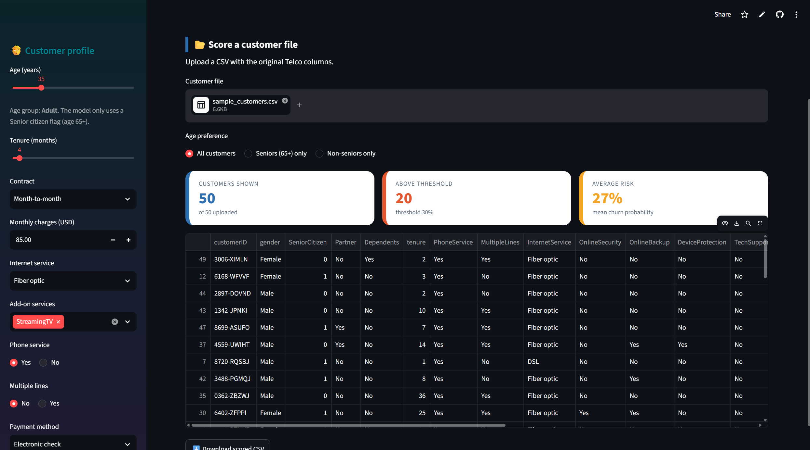
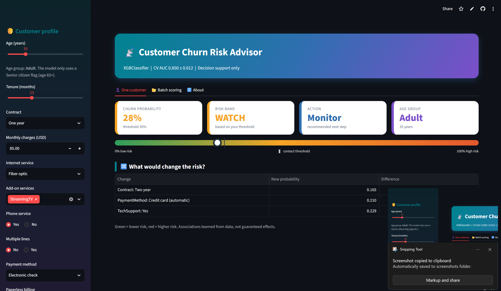

# Churn Risk Advisor

A Streamlit web app that scores telecom customers for churn risk, shows which changes would lower that risk, and scores whole customer files in one go.

**Live app:** https://applied-ai-project1-churn-us35rrybbr9qmta9uqexdv.streamlit.app/  <!-- replace with your real Streamlit URL -->





---

## Model card: Churn Risk Advisor v1.0

**Intended use:** rank existing telecom customers by churn risk so a retention team can prioritize calls. Decision support, not automation.

**Not for:** credit, pricing, or any decision that denies a service.

**Data:** IBM Telco Customer Churn, 7,043 customers, 26.5% churn.

**Model:** XGBoost (`XGBClassifier`), tuned with randomized search and chosen by 5-fold CV. Features: 30 encoded columns.

**Performance:** CV AUC 0.8502 ± 0.0117; test AUC 0.8483 (test set used once).

**Threshold:** 0.30, from a cost analysis (FN = PKR 6,000, FP = PKR 1,000).

**Limitations:** one US dataset from one period; no Pakistan data; associations, not causes; performance may drift as plans change.

**Fairness check (Week 15):** compare recall across gender and seniors.

**Owner and version:** Raja Fahad Kiyani, v1.0, 12 October 2026.

---

## How the numbers in the model card were obtained

### 1. Data and split

One-hot encoding turns a column with $k$ categories into $k-1$ indicator columns:

$$\text{encoded columns} = \underbrace{4}_{\text{numeric}} + \underbrace{\sum_j (k_j - 1)}_{26\ \text{dummy columns}} = 30$$

A stratified 80/20 split keeps the churn rate the same in both parts:

$$n_{test} = \lceil 0.2 \times 7043 \rceil = 1409, \qquad n_{train} = 7043 - 1409 = 5634$$

The majority-class baseline (always predict "stays") scores

$$\text{baseline accuracy} = 1 - 0.265 = 0.735$$

### 2. Performance: mean ± standard deviation over 5 folds

The model was selected using stratified 5-fold cross-validation on the training set only:

$$\overline{AUC} = \frac{1}{K}\sum_{k=1}^{K} AUC_k = 0.8502, \qquad \sigma = \sqrt{\frac{1}{K}\sum_{k=1}^{K}\left(AUC_k - \overline{AUC}\right)^2} = 0.0117, \qquad K = 5$$

AUC is the probability that a randomly chosen churner is scored higher than a randomly chosen non-churner:

$$AUC = P\big(\text{score}(\text{churner}) > \text{score}(\text{non-churner})\big)$$

Standard error of the fold average, and the gap to the next-best model (Random Forest, CV AUC 0.8464):

$$SE = \frac{\sigma}{\sqrt{K}} = \frac{0.0117}{\sqrt{5}} \approx 0.0052, \qquad \Delta = 0.8502 - 0.8464 = 0.0038 < 1\,SE$$

The gap is within noise, so XGBoost is only marginally ahead. Logistic Regression and Random Forest tied at 0.8464.

The locked test set was scored once:

$$AUC_{test} = 0.8483, \qquad |AUC_{CV} - AUC_{test}| = |0.8502 - 0.8483| = 0.0019 \ll \sigma = 0.0117$$

The CV estimate matches the test result, so there is no sign of over-fitting to the validation folds.

| Model | CV AUC (mean ± std) |
|---|---|
| Logistic Regression (tuned C = 10) | 0.8464 ± 0.0129 |
| Random Forest (random search) | 0.8464 ± 0.0114 |
| **XGBoost (tuned)** | **0.8502 ± 0.0117** |

Tuned XGBoost settings: `max_depth = 2`, `learning_rate = 0.034`, `n_estimators = 476`, `subsample = 0.6`, `colsample_bytree = 0.561`, `min_child_weight = 1`, `reg_lambda = 1.974`.

### 3. Test-set metrics at the 0.5 cut-off (approximate reconstruction)

$$\text{Recall} = \frac{TP}{TP+FN} = 0.521, \qquad \text{Precision} = \frac{TP}{TP+FP} = 0.659, \qquad F_1 = \frac{2PR}{P+R} \approx 0.58$$

The confusion matrix was not printed, so the counts below are reconstructed from these rates and the expected 374 churners in the test set ($0.265 \times 1409$):

$$TP \approx 0.521 \times 374 \approx 195, \quad FN \approx 179, \quad FP \approx \frac{195}{0.659} - 195 \approx 101, \quad TN \approx 934$$

### 4. Decision threshold (cost analysis)

Contact a customer when the expected cost of ignoring a churner is larger than the cost of a wasted contact:

$$p \cdot C_{FN} > (1-p)\cdot C_{FP} \;\Longrightarrow\; p > \frac{C_{FP}}{C_{FP}+C_{FN}} = \frac{1{,}000}{7{,}000} \approx 0.143$$

That break-even assumes every contact saves a churner. If a retention offer succeeds with probability $s$:

$$p > \frac{C_{FP}}{s \cdot C_{FN}}$$

The chosen threshold $t = 0.30$ corresponds to

$$s = \frac{C_{FP}}{t \cdot C_{FN}} = \frac{1{,}000}{0.30 \times 6{,}000} \approx 0.56$$

so it assumes about a 56% save rate. Total cost of a set of decisions:

$$\text{Cost} = C_{FN}\cdot FN + C_{FP}\cdot FP$$

For reference, the reconstructed 0.5 cut-off on the test set costs about $179 \times 6{,}000 + 101 \times 1{,}000 \approx \text{PKR } 1.18$ million. Lowering the cut-off to 0.30 catches more churners at the price of more wasted contacts, which is why the app uses 0.30.

### 5. Risk bands shown in the app

$$\text{band}(p) = \begin{cases} \text{HIGH (contact now)} & p \ge t \\ \text{WATCH} & t/2 \le p < t \\ \text{LOW} & p < t/2 \end{cases} \qquad t = 0.30 \text{ by default (adjustable in the sidebar)}$$

---

## Making sure the app answers like the notebook

### Training-serving skew

Using `get_dummies(drop_first=True)` on a single customer drops the only category present, so a two-year-contract customer looks like a month-to-month one:

| Encoding | Contract columns | P(churn) |
|---|---|---|
| Wrong (`drop_first=True`, one row) | `[0, 0]` | 0.136 |
| Right (`prepare_input`) | `[0, 1]` | 0.012 |

$$\text{odds ratio} = \frac{0.136/0.864}{0.012/0.988} = \frac{0.157}{0.0121} \approx 13$$

No error is raised, so the app would silently overstate this customer's risk about 13 times in odds terms. The app therefore encodes with every category kept, then re-indexes to the 30 training columns.

### Parity test

$$\Delta_{max} = \max_{i=1,\dots,7043}\big|p_i^{train} - p_i^{serve}\big| = 0.0$$

Passed on all 7,043 customers, so the app's input path reproduces the notebook exactly. Re-run it whenever the model, the encoding or a library version changes.

### Derived input

$$TotalCharges \approx tenure \times MonthlyCharges$$

The app calculates this itself so users cannot enter impossible combinations.

### What-if analysis

For a change to one input:

$$\Delta = p' - p, \qquad \text{relative reduction} = \frac{p - p'}{p}$$

Example from the notebook, riskiest customer with baseline $p = 0.935$:

| Change | New $p$ | $\Delta$ | Relative reduction |
|---|---|---|---|
| One-year contract | 0.862 | −0.073 | 7.8% |
| Two-year contract | 0.765 | −0.170 | 18.2% |
| Credit card (automatic) | 0.913 | −0.022 | 2.4% |

These are associations learned from past customers, not proven effects. A randomized offer test would be needed to show that offering a contract makes someone stay.

### About the age input

The training data has no exact age, only a `SeniorCitizen` flag. The age slider converts age 65 and above to that flag:

$$\text{SeniorCitizen} = \mathbf{1}[\text{age} \ge 65]$$

so two customers on either side of the cutoff score differently, but customers of different ages on the same side score the same.

---

## Customer segments (K-means, k = 4)

| Cluster | Customers | Avg tenure (months) | Avg monthly (USD) | Services | Churn rate |
|---|---|---|---|---|---|
| 1 (riskiest) | 2,157 | 18.4 | 80.41 | 3.28 | 43% |
| 3 | 1,918 | 9.0 | 37.71 | 1.20 | 32% |
| 2 | 1,938 | 59.8 | 92.09 | 5.06 | 14% |
| 0 | 1,030 | 53.6 | 30.96 | 1.48 | 5% |

Consistency check, the weighted churn rate recovers the overall rate:

$$\frac{2157(0.43) + 1918(0.32) + 1938(0.14) + 1030(0.05)}{7043} = \frac{1864}{7043} \approx 0.265$$

Cluster 1 holds 30.6% of customers but about half of all churners:

$$\text{share of churners} = \frac{2157 \times 0.43}{1864} \approx 0.50, \qquad \text{lift} = \frac{0.43}{0.265} \approx 1.62$$

---

## Run locally

```bash
mkdir churn-risk-advisor
cd churn-risk-advisor
# copy in: app.py, churn_model.joblib, model_meta.json, sample_customers.csv, requirements.txt
python -m venv .venv
.venv\Scripts\activate          # Windows (Mac/Linux: source .venv/bin/activate)
pip install -r requirements.txt
streamlit run app.py
```

`requirements.txt` pins the library versions used for training, because the saved model can only be loaded safely with the same scikit-learn:

```
streamlit>=1.32
scikit-learn==1.6.1
pandas
numpy
joblib
xgboost==YOUR_XGBOOST_VERSION
matplotlib
```

## Repository contents

```
churn-risk-advisor/
├── app.py
├── churn_model.joblib
├── model_meta.json
├── requirements.txt
├── sample_customers.csv     # 50 customers for the batch demo
├── README.md                # this file with the model card
└── screenshots/
```

## Notebooks

- Week 1: https://www.kaggle.com/YOUR-LINK-WEEK-1
- Week 2: https://www.kaggle.com/YOUR-LINK-WEEK-2
- Week 3 and 4: https://www.kaggle.com/YOUR-LINK-WEEK-3

## Security note

Loading a joblib or pickle file runs code stored inside it. Only load `churn_model.joblib` from this repository, never a model file from a source you do not trust.
